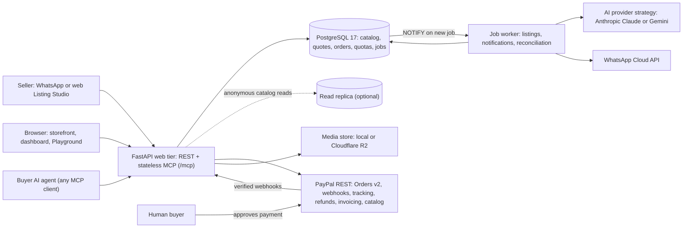

# AgentShelf

**Made by you. Found by AI.** AgentShelf turns a small seller's WhatsApp product photos into a store that any AI shopping agent can search, quote and buy from over MCP, with prices set by the seller and every payment approved by a human on PayPal.

> **Status:** hackathon project (PayPal AI Hackathon). The Must and Should workflows are implemented and tested locally against PostgreSQL with controlled provider responses, and parts of the buyer path have been run against real Gemini and PayPal **sandbox**. Production and pilot acceptance are deliberately **not** claimed (`gate_approval: False`) until real-credential staging evidence exists. See [docs/STATUS.md](docs/STATUS.md).

## Links

| What | Where |
|---|---|
| Live demo (PayPal sandbox), as listed in [docs/DEVPOST_SUBMISSION.md](docs/DEVPOST_SUBMISSION.md) | https://agentshelf-frontend.vercel.app (Buyer Playground at `/playground`) |
| Local storefront (after setup) | `http://localhost:5173/s/meera-jaipur` |
| Local Buyer Playground (SSE + MCP trace) | `http://localhost:5173/playground` |
| Local seller dashboard and Copilot | `http://localhost:5173/dashboard` |
| MCP Streamable HTTP endpoint | `http://localhost:8000/mcp` |
| Agent discovery metadata | `http://localhost:8000/.well-known/mcp.json` |
| OpenAPI docs | `http://localhost:8000/docs` |
| Devpost text and demo script | [docs/DEVPOST_SUBMISSION.md](docs/DEVPOST_SUBMISSION.md), [docs/DEMO_WALKTHROUGH_SCRIPT.md](docs/DEMO_WALKTHROUGH_SCRIPT.md) |

## Overview

Independent artisans and small merchants often run their whole business inside WhatsApp: product photos, voice notes, "is this still available?" and hand-typed payment links. Shoppers are starting to buy through AI assistants, and those assistants cannot read a WhatsApp thread. They need a catalog they can search, a price they can trust and a checkout they can call.

AgentShelf gives these sellers an agent-ready store without asking them to learn e-commerce:

- **For sellers**: photos (and an optional voice note) in, a structured listing out. A vision model drafts the title, description, category and attributes, but the **seller always confirms price and stock** before anything goes live.
- **For buyers' AI agents**: every store is exposed through a public page with schema.org data and a standard **MCP server** with four tools (`search_products`, `get_quote`, `create_checkout`, `get_order_status`).
- **For trust**: the server is the only source of truth for prices, stock, shipping, budgets and payment state. Agents find and propose; a **human approves every payment** on PayPal, and money goes directly to the seller.

## Key features

**Seller side**
- Listing workflow from 1 to 4 photos via WhatsApp or the web Listing Studio: EXIF stripping, private media storage (local or Cloudflare R2), AI draft validated against a strict schema, seller confirmation of price and stock.
- WhatsApp Cloud API integration: inbound photos and voice notes (transcribed), text commands such as `price 45 #12`, `stock 0 #12` and `track #<order> <carrier> <tracking-number>`, and paid-order notifications.
- Seller dashboard (AG Grid) with products and orders, passwordless email sign-in (single-use hashed links, hashed sessions, CSRF protection), tracking upload, refunds, custom invoices, PayPal Catalog sync and a 7-day sales and stock summary.
- AG Studio analytics assistant that answers questions over aggregated store metrics only (enabled when a licence key is supplied; always on in development).
- Listing copy translation to `es`, `fr`, `de`, `hi` and `ja`, while prices and stock stay server-side.

**Buyer and agent side**
- Public storefronts at `/s/{slug}` with schema.org Product JSON-LD (`/api/stores/{slug}/schema.json`).
- Stateless Streamable HTTP MCP server built on the official MCP Python SDK, discoverable at `/.well-known/mcp.json` and usable from Claude Desktop, Cursor or MCP Inspector ([evals/mcp_client_config.json](evals/mcp_client_config.json)).
- Ranked PostgreSQL full-text search (weighted `tsvector` + GIN index).
- Immutable 15-minute quotes with item and shipping totals in integer minor units.
- Buyer Playground: a chat with an AI shopping agent that connects to the real MCP server, streams every tool call over SSE, enforces a session budget and requires explicit confirmation before checkout.

**Payments and operations**
- PayPal REST integration with idempotency keys and a circuit breaker (see the matrix below).
- Durable Postgres job queue (`FOR UPDATE SKIP LOCKED`, LISTEN/NOTIFY wake-ups, retries with backoff, de-duplication) processed by a separate worker.
- Payment reconciliation, operator console (`/operations`) for job retry and order correlation, worker heartbeat, media and privacy maintenance jobs.
- Edge hardening: request IDs, per-identity quotas using the trusted rightmost `X-Forwarded-For` hop, body-size limits, request deadlines, security headers (HSTS, COOP, CSP), error envelopes, Sentry hooks.
- Horizontal scaling options: `WEB_CONCURRENCY`, an nginx reference stack with two web replicas and an optional streaming read replica for anonymous catalog reads ([deploy/scale/](deploy/scale/)).

## Architecture



| Layer | Modules (in [`backend/app/`](backend/app/)) |
|---|---|
| Composition root | `main.py`: middleware, routers, MCP transport, static frontend assets |
| Edge | `http_edge.py` (request ID, quotas, deadlines, headers, error envelopes), `rate_limits.py`, `body_limits.py` |
| HTTP adapters | `routes/public.py`, `routes/sellers.py`, `routes/listings.py`, `routes/webhooks.py`, `routes/operations.py`, `routes/analytics.py`, `routes/playground.py`, `mcp_server.py` |
| Business services | `storefront.py`, `quotes.py`, `orders.py`, `seller_catalog.py`, `listing_workflow.py`, `whatsapp_workflow.py`, `tracking.py`, `copilot.py`, `reconciliation.py`, `payment_adjustments.py`, `auth.py` |
| Agents | `llm.py` (listing drafts, transcription, translation, analytics), `buyer_agent.py` (Playground agent over a real MCP client), `ai_providers.py` (Anthropic and Gemini adapters) |
| Messaging | `jobs.py` (job registry, retries, compensation), `job_signals.py` (LISTEN/NOTIFY), [`backend/worker.py`](backend/worker.py) |
| Provider boundaries | `paypal.py`, `whatsapp.py`, `storage.py`, `email.py` (Resend) |
| Cross-cutting | `db.py` (primary and read pools, timeouts), `cache.py`, `resilience.py`, `config.py`, `observability.py`, `guards.py` (personal-data and prompt-injection screening) |

Design decisions are recorded in [docs/ARCHITECTURE.md](docs/ARCHITECTURE.md) and six ADRs in [docs/adr/](docs/adr/) (PayPal payee model, capacity and bottlenecks, caching and read replicas, edge identity and quotas, failure handling and messaging, module structure).

## How it works

### Seller: from photo to live listing

1. The seller sends photos (and optionally a caption or voice note) on WhatsApp, or uploads them in the Listing Studio (`POST /api/me/media`, `POST /api/me/listings`).
2. Images are stripped of EXIF metadata and stored privately; captions are screened for personal data.
3. A queued job asks the configured model to draft a listing; the draft is validated against a strict schema and rejected if it contains invented or unsafe content.
4. The seller reviews the draft and **sets price and stock**, then publishes (`POST /api/me/listings/{id}/publish`). Prices and stock can later be edited by text command or in the dashboard.

### Buyer agent: from question to paid order

1. An MCP client calls `search_products` against live PostgreSQL data.
2. `get_quote` snapshots item price, shipping and a 15-minute expiry on the server, in integer minor units. The model cannot supply or change an amount.
3. `create_checkout` reserves stock with `SELECT ... FOR UPDATE`, checks the session's cumulative budget (shipping and existing reservations included) and creates **one** PayPal Orders v2 order for that quote, paid directly to the seller.
4. The human buyer approves the payment on PayPal; the server verifies the order and captures the exact amount.
5. A verified PayPal webhook reconciles the capture and queues the seller's WhatsApp notification.
6. The seller adds tracking (dashboard or WhatsApp `track #<order> <carrier> <tracking-number>`); it is pushed to PayPal via `POST /v1/shipping/trackers-batch` and shown on the buyer receipt.

### Trust boundary

Models never own prices, stock, shipping, budgets or payment approval. Catalog text is treated as untrusted data in agent prompts, street addresses, emails, phone numbers and secrets are kept out of prompts and logs, and session IDs are bound by the host so a model cannot act on another buyer's session.

## PayPal integration matrix

| PayPal capability | Endpoint | Implementation |
|---|---|---|
| OAuth 2.0 token | `POST /v1/oauth2/token` | Cached client credentials in `backend/app/paypal.py` |
| Create order with direct payee | `POST /v2/checkout/orders` | Server quote, `PayPal-Request-Id`, `payee.email_address`, approval URL validation |
| Read order | `GET /v2/checkout/orders/{id}` | Approval, 15-minute reservation expiry, capture reconciliation |
| Capture order | `POST /v2/checkout/orders/{id}/capture` | Locked local order and exact minor-unit amount verification |
| Verify webhook signature | `POST /v1/notifications/verify-webhook-signature` | Five signature headers plus registered `PAYPAL_WEBHOOK_ID` |
| Shipping trackers | `POST /v1/shipping/trackers-batch` | Seller tracking via dashboard or WhatsApp |
| Capture refunds | `POST /v2/payments/captures/{id}/refund` | Seller Copilot refund plus verified webhook accounting |
| Invoicing | `POST /v2/invoicing/invoices` and `/send` | Seller Copilot custom invoices |
| Catalog Products | `POST /v1/catalogs/products` | Mirror AgentShelf products to the PayPal Catalog |

## MCP tools

| Tool | Input | Result |
|---|---|---|
| `search_products` | `query`, `max_price?`, `currency=USD`, `ship_to_country?`, `limit=5` (max 10) | Products with IDs, prices, stock and URLs |
| `get_quote` | `product_id`, `qty`, `ship_to_country`, `session_id` | Stored quote with exact shipping, total and 15-minute expiry |
| `create_checkout` | `quote_id`, `session_id` | Stable order and human approval URL |
| `get_order_status` | `order_id`, `session_id` | Scoped order status, amount and tracking |

A buyer session with an integer `budget_minor` is created with `POST /api/playground/sessions`. Example:

```json
{"name": "search_products", "arguments": {"query": "scarf", "ship_to_country": "GB", "limit": 5}}
```

Full details: [docs/MCP.md](docs/MCP.md).

## Tech stack

| Layer | Technologies |
|---|---|
| Backend | Python 3.12, FastAPI, Uvicorn, Pydantic Settings, SQLAlchemy 2, Alembic, psycopg 3, httpx |
| Agent protocol | Official MCP Python SDK (stateless Streamable HTTP), Server-Sent Events |
| AI | Anthropic Claude (`anthropic` SDK) and Google Gemini behind one provider interface; Anthropic is preferred when both keys are set |
| Database | PostgreSQL 17 (row locks, constraints, weighted full-text search, LISTEN/NOTIFY, optional streaming replica) |
| Frontend | React 19, TypeScript, Vite, React Router 7, AG Grid, AG Studio, lucide-react, Sentry browser SDK |
| Integrations | PayPal REST APIs, WhatsApp Cloud API, Cloudflare R2 (boto3), Resend email |
| Image processing | Pillow |
| Testing and quality | pytest (real PostgreSQL), Playwright with axe-core accessibility scans, ruff, ESLint, Prettier, pip-audit, npm audit, gitleaks |
| Delivery | Docker (multi-stage), Docker Compose, GitHub Actions, Render blueprint, Hugging Face Space (API) + Vercel (frontend), nginx reference stack |

## Project structure

```text
AgentShelf/
├── backend/
│   ├── app/                    # FastAPI application (see module table above)
│   │   └── routes/             # REST adapters: public, sellers, listings, webhooks, operations, analytics, playground
│   ├── migrations/             # Alembic migrations
│   ├── tests/                  # 47 test modules against real PostgreSQL
│   ├── worker.py               # durable job worker
│   ├── seed.py                 # loads the demo store from seed/demo_store.json
│   ├── maintenance.py          # demo reset and maintenance commands
│   ├── evaluate_listings.py    # listing-quality evaluation runner and scorer
│   ├── evaluate_buyers.py      # buyer-agent task evaluation
│   ├── evaluate_search.py      # MCP search latency benchmark
│   ├── verify_phase_b.py       # provider credential preflight and sandbox payee spike
│   └── pyproject.toml          # uv-managed dependencies
├── frontend/
│   ├── src/
│   │   ├── pages/              # Home, StorePage, Playground, Receipt
│   │   ├── AiBuyer.tsx         # SSE Buyer Playground chat
│   │   ├── Seller.tsx          # seller dashboard and Copilot
│   │   ├── ListingStudio.tsx   # photo-to-listing studio
│   │   ├── AnalyticsStudio.tsx # AG Studio analytics assistant
│   │   └── Operations.tsx      # operator console
│   ├── tests/e2e/              # Playwright + axe browser tests
│   └── vercel.json             # frontend hosting with API rewrites
├── seed/demo_store.json        # synthetic demo store (meera-jaipur)
├── evals/                      # evaluation guide, templates, MCP client config
├── deploy/
│   ├── huggingface/            # Docker Space: single-container API (API + worker + migrations)
│   └── scale/                  # nginx + two web replicas + primary/replica Postgres
├── docs/                       # architecture, ADRs, runbook, status, roadmap, Devpost text
├── scripts/                    # start-local.ps1, uptime probe, container verification
├── .github/workflows/          # CI, nightly sandbox verification, staging uptime
├── Dockerfile                  # builds frontend and serves it from the API image
├── docker-compose.yml          # local PostgreSQL 17
├── render.yaml                 # Render staging blueprint (API, worker, database)
└── Makefile                    # setup, db, migrate, seed, api, worker, web, test
```

## Getting started

### Prerequisites

- Python 3.12 and [uv](https://docs.astral.sh/uv/)
- Node.js 22 and npm
- Docker (for the local PostgreSQL 17 container)

### Quick start on Windows (PowerShell)

```powershell
./scripts/start-local.ps1
```

The script copies `.env.example` to `.env` if missing, starts PostgreSQL, installs locked dependencies, runs migrations, seeds the demo store and starts the API, web app and worker in the background (logs in `work/`).

### Manual setup (any OS)

```bash
cp .env.example .env     # then set DATABASE_URL to match your database (see note below)
make setup               # uv sync --frozen + npm ci
make db                  # docker compose up -d db
make migrate             # alembic upgrade head
make demo-reset          # seed the demo store and reset synthetic sandbox stock
make api                 # API on http://127.0.0.1:8000
make worker              # job worker (separate terminal)
make web                 # frontend on http://127.0.0.1:5173 (separate terminal)
```

> **Database URL:** the `db` service in [`docker-compose.yml`](docker-compose.yml) listens on `localhost:5433` with user and database `agentshelf`, while the sample `DATABASE_URL` in `.env.example` points to `localhost:5432`. Point `DATABASE_URL` at whichever PostgreSQL you run, using the `postgresql+psycopg://` scheme.

Without any provider keys the storefront, MCP server, quotes and local checkout logic still run; AI drafting, real PayPal calls, WhatsApp and email need credentials. [docs/RUNBOOK.md](docs/RUNBOOK.md) covers sandbox account setup, webhooks, recovery and backups.

### Environment variables

Names and purpose only; see [`.env.example`](.env.example) and `backend/app/config.py` for the full list.

| Variable | Purpose |
|---|---|
| `APP_ENV` | `local`, `test`, `staging` or `production`; staging/production enforce stricter checks (same-origin URLs, R2 media, etc.) |
| `DATABASE_URL`, `DATABASE_READ_URL` | Primary and optional read-replica PostgreSQL URLs |
| `PUBLIC_API_URL`, `FRONTEND_URL` | Public origins of the API and the web app |
| `DB_POOL_SIZE`, `DB_MAX_OVERFLOW`, `DB_STATEMENT_TIMEOUT_MS`, `DB_NETWORK_TIMEOUT_MS`, `REQUEST_DEADLINE_SECONDS`, `PROVIDER_REQUEST_DEADLINE_SECONDS`, `PUBLIC_CACHE_SECONDS` | Pooling, timeouts and cache tuning |
| `TRUSTED_PROXY_HOPS`, `SERVICE_SIGNING_KEY`, `WEB_CONCURRENCY`, `FORWARDED_ALLOW_IPS` | Proxy trust, signed internal MCP calls and worker count |
| `PAYPAL_MODE`, `PAYPAL_CLIENT_ID`, `PAYPAL_CLIENT_SECRET`, `PAYPAL_WEBHOOK_ID` | PayPal sandbox/live configuration |
| `LIVE_CHECKOUT_ENABLED`, `LIVE_MERCHANT_ID` | Explicit gate required before live mode is accepted |
| `ANTHROPIC_API_KEY`, `ANTHROPIC_MODEL` | Claude provider |
| `GEMINI_API_KEY`, `GEMINI_MODEL`, `GEMINI_THINKING_LEVEL` | Gemini provider and reasoning depth |
| `MEDIA_BACKEND`, `R2_ENDPOINT`, `R2_BUCKET`, `R2_ACCESS_KEY_ID`, `R2_SECRET_ACCESS_KEY` | Local or Cloudflare R2 media storage |
| `WHATSAPP_APP_SECRET`, `WHATSAPP_VERIFY_TOKEN`, `WHATSAPP_ACCESS_TOKEN`, `WHATSAPP_PHONE_NUMBER_ID`, `WHATSAPP_PAID_TEMPLATE`, `WHATSAPP_TEMPLATE_LANGUAGE` | WhatsApp Cloud API |
| `RESEND_API_KEY`, `EMAIL_FROM` | Sign-in link emails |
| `SENTRY_DSN`, `BROWSER_SENTRY_DSN` | Error monitoring |
| `VITE_AG_STUDIO_LICENSE_KEY` | Frontend build: enables AG Studio outside development |
| `VITE_STREAM_API_URL` | Frontend build: direct API host for SSE streaming when the frontend is behind a buffering proxy |

### Tests and checks

```bash
make test                          # backend pytest; TEST_DATABASE_URL must point to an isolated database ending in _test
                                   # (default: agentshelf_test on the compose database, localhost:5433)
cd backend && uv run ruff check .  # lint
cd frontend && npm run lint && npm run build
cd frontend && npm run test:e2e    # Playwright + axe (needs the API running with seeded data)
```

CI ([`.github/workflows/ci.yml`](.github/workflows/ci.yml)) runs five jobs: backend (ruff, migration up/down/up, pytest, pip-audit), frontend (lint, format, build, npm audit), browser (Playwright on development and packaged builds), secrets (gitleaks over full history) and container (build, migrate, seed, smoke-test API and worker). A nightly workflow runs sandbox verification, and an uptime workflow probes staging once a staging origin is configured.

### Docker

```bash
docker build -t agentshelf .
```

The image builds the frontend and serves it from the FastAPI app as a non-root user. The worker uses the same image with `python worker.py`. [`render.yaml`](render.yaml) provisions a sandbox staging API, worker and database on Render, and [`deploy/huggingface/`](deploy/huggingface/) runs migrations, seed, worker and API in a single container.

### Hugging Face Space (API behind the Vercel frontend)

The hosted API runs as a Hugging Face **Docker** Space (`sdk: docker`, `app_port: 7860`). It installs the backend from `backend/uv.lock`, so it gets the same patched dependencies as every other deployment, and runs as uid 1000 with `SERVE_FRONTEND=false`; [`frontend/vercel.json`](frontend/vercel.json) forwards API paths to it.

```bash
deploy/huggingface/build-space.sh ../agentshelf-space   # README.md, Dockerfile, start.sh, backend/ (no tests), seed/
```

Push the generated repository to the Space. Configuration (`APP_ENV`, `DATABASE_URL`, PayPal, R2, provider keys) comes from the Space's variables and secrets, which the container receives as environment variables. The app needs no GPU, and ZeroGPU is only available to Gradio Spaces, so the Space runs on CPU basic hardware.

## Evaluation harnesses

Described in [evals/README.md](evals/README.md):

- **Listing quality** ([`backend/evaluate_listings.py`](backend/evaluate_listings.py)): runs 20 real products through the actual drafting pipeline and scores two independent human reviews (target at least 4.0/5, zero invented claims, p95 under 8 s).
- **Buyer agent** ([`backend/evaluate_buyers.py`](backend/evaluate_buyers.py)): 15 sandbox tasks covering stock, budget, ambiguity, destination and prompt injection.
- **MCP search latency** ([`backend/evaluate_search.py`](backend/evaluate_search.py)): 20 queries over real Streamable HTTP against at least 1,000 products (target p95 under 1 s).
- **Provider readiness** ([`backend/verify_phase_b.py`](backend/verify_phase_b.py), `make phase-b-preflight`): checks provider configuration and runs the sandbox payee spike from ADR-001.

The listing-quality and buyer-task evaluations with real providers have **not** been completed yet.

## Recorded results

All figures below come from [docs/STATUS.md](docs/STATUS.md) and were measured **locally** (isolated PostgreSQL 17, mostly with controlled provider responses). They are not staging or production measurements.

| Check | Result |
|---|---|
| Backend test suite | 340 passed, 1 skipped (latest recorded run) |
| Browser suite (Playwright + axe) | 16/16 passed, including mobile accessibility scans of every public screen |
| Catalog search scale | 1,000-product full-text search, local p95 under 1 s |
| Product listing throughput | `/api/products` at concurrency 100 on one worker: 151 req/s, p95 2.8 s |
| Load-balanced stack (`deploy/scale`) | Requests split across two replicas; 0 errors when one replica was stopped mid-burst |
| Hung or partitioned database | Requests fail fast with 503 in 3 to 15 s and recover on the next check |
| Real Gemini + MCP + PayPal sandbox buyer path | 4 searches and a quote in 12.7 s; after human confirmation, PayPal order created in 3.1 s with matching amount and payee. Approval, capture and webhooks were not yet exercised end to end |
| Real Gemini listing drafts | Two photo drafts returned valid listings in 4.4 s and 10.0 s |

## Limitations and roadmap

- **Acceptance gates open.** Hosted staging, PayPal webhook registration, a full buyer-approved capture with webhooks, the 20-item human listing evaluation and the buyer-task evaluation are still pending real credentials and a public HTTPS deployment.
- **Live payments are gated.** Live mode requires `LIVE_CHECKOUT_ENABLED` and a verified `LIVE_MERCHANT_ID`; merchant eligibility is checked one seller at a time and universal support is not implied.
- Known gaps recorded in STATUS.md: CSP still allows `style-src 'unsafe-inline'`; services obtain database sessions from module factories rather than an injected unit of work; a model-rejected draft finishes its job without exposing the rejection code to operators.
- Gemini free-tier quotas (20 requests per day per model) limit real-provider testing.
- Planned next steps (from the Devpost write-up): a pilot with real sellers in India selling to overseas buyers, more agent surfaces through the same MCP endpoint, voice-first listing in regional languages, payouts for sellers who cannot receive payments directly, and shipping-label integration.

## Further documentation

| Document | Contents |
|---|---|
| [docs/ARCHITECTURE.md](docs/ARCHITECTURE.md) | System diagram, module map, design process |
| [docs/MCP.md](docs/MCP.md) | MCP tools, discovery and client rules |
| [docs/RUNBOOK.md](docs/RUNBOOK.md) | Local operation, sandbox setup, recovery, backups, configuration |
| [docs/STATUS.md](docs/STATUS.md) | Dated evidence log and open gaps |
| [docs/IMPLEMENTATION_PLAN.md](docs/IMPLEMENTATION_PLAN.md), [docs/ROADMAP_SOURCE.md](docs/ROADMAP_SOURCE.md) | Requirements and plan |
| [docs/OWNER_HANDOFF.md](docs/OWNER_HANDOFF.md), [docs/DELIVERY_CHECKLIST.md](docs/DELIVERY_CHECKLIST.md) | Handoff and release checklist |
| [docs/BUILD_GUIDE.pdf](docs/BUILD_GUIDE.pdf) | Original hackathon build guide (kept unchanged) |

## Author

Built by [Suriyaprakash](https://github.com/suriyaprakash-25) for the PayPal AI Hackathon, using Python, FastAPI, the official MCP SDK, PostgreSQL and React. No production merchant eligibility, live payment guarantee or competition outcome is implied.

## License

[MIT](LICENSE)
