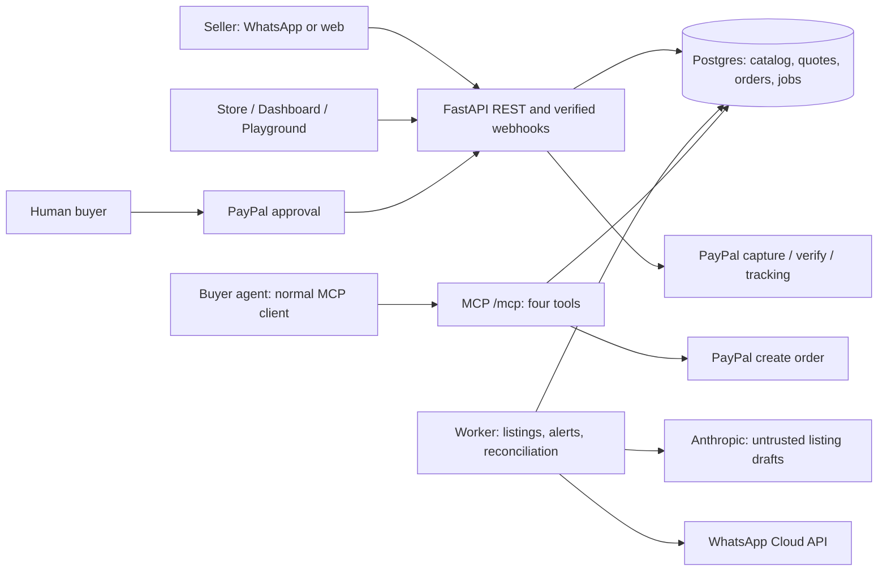

# Architecture

One backend and worker share business functions and Postgres. Money is integer USD
minor units. Quote snapshots are immutable. Only available stock is shown; every
reservation and terminal release is transactional. The model cannot supply a price.
Sandbox and live use separate deployments and databases. The live merchant and its
permissions must be verified before live checkout is enabled.

See IMPLEMENTATION_PLAN.md for correctness details and STATUS.md for actual coverage.
