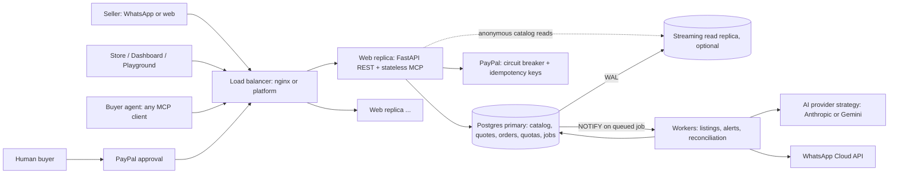

# Architecture

All instances share business modules and Postgres. Money is integer USD minor units.
Quote snapshots are immutable. Every reservation and terminal release is
transactional, and the model cannot supply a price. Sandbox and live use separate
deployments and databases. A live merchant and its permissions must be verified before
live checkout is enabled; nothing here implies universal merchant support.

## Module map

| Layer | Modules |
| --- | --- |
| Composition root | `main.py`: middleware, routers, stateless MCP transport, static assets |
| Edge | `http_edge.py` (request ID, quotas, deadlines, headers, error envelopes); `rate_limits.py`; `body_limits.py` |
| HTTP adapters | `routes/public.py`, `routes/sellers.py`, `routes/listings.py`, `routes/webhooks.py`, `routes/operations.py`, `routes/analytics.py`, `routes/playground.py`, `mcp_server.py` |
| Services (rules) | `storefront.py`, `quotes.py`, `orders.py`, `seller_catalog.py`, `listing_workflow.py`, `whatsapp_workflow.py`, `tracking.py`, `copilot.py`, `reconciliation.py`, `payment_adjustments.py`, `auth.py` |
| Messaging | `jobs.py` (registry, retries), `job_signals.py` (LISTEN/NOTIFY), `worker.py` |
| Provider boundaries | `paypal.py`, `llm.py` + `ai_providers.py`, `storage.py`, `whatsapp.py`, `email.py` |
| Cross-cutting | `db.py` (primary and read pools, timeouts), `cache.py`, `resilience.py`, `config.py`, `observability.py` |

## HLD design process

| Step | Decision | Record |
| --- | --- | --- |
| 1 Requirements | Must/Should list, acceptance criteria and NFR targets | `ROADMAP_SOURCE.md`, `IMPLEMENTATION_PLAN.md` |
| 2 Estimate scale | Pilot and design envelope (50k products, 50 reads/s, 1 checkout/s) | ADR-002 |
| 3 Components | Stateless web tier, workers, Postgres, provider facades | This page |
| 4 Data flow | Quote → reserve → approve → capture → webhook → notify | `README.md`, `IMPLEMENTATION_PLAN.md` |
| 5 Database | Postgres with constraints, row locks, weighted tsvector + GIN, hot-path indexes, optional replica | Migrations, ADR-003 |
| 6 Cache | In-process TTL cache with single flight for anonymous reads; never money or sessions | ADR-003 |
| 7 Load balancing | Stateless MCP, `WEB_CONCURRENCY`, nginx reference stack, trusted-proxy identity | ADR-002, ADR-004, `deploy/scale/` |
| 8 Messaging | Durable jobs table, SKIP LOCKED, backoff, dedupe, LISTEN/NOTIFY | ADR-005 |
| 9 Failures | DB timeouts, request deadlines, fast health, PayPal breaker, reconciliation | ADR-005, ADR-001 |
| 10 Security | Rightmost-hop identity, signed internal calls, HSTS/COOP/CSP, CSRF, hashed tokens, verified webhooks | ADR-004 |
| 11 Bottlenecks | Single write primary, thread-pool handlers, locked capture, quota hot rows | ADR-002 |
| 12 Trade-offs | Each ADR lists what was rejected and why | ADR-001…006 |

See `IMPLEMENTATION_PLAN.md` for correctness details and `STATUS.md` for actual coverage.
